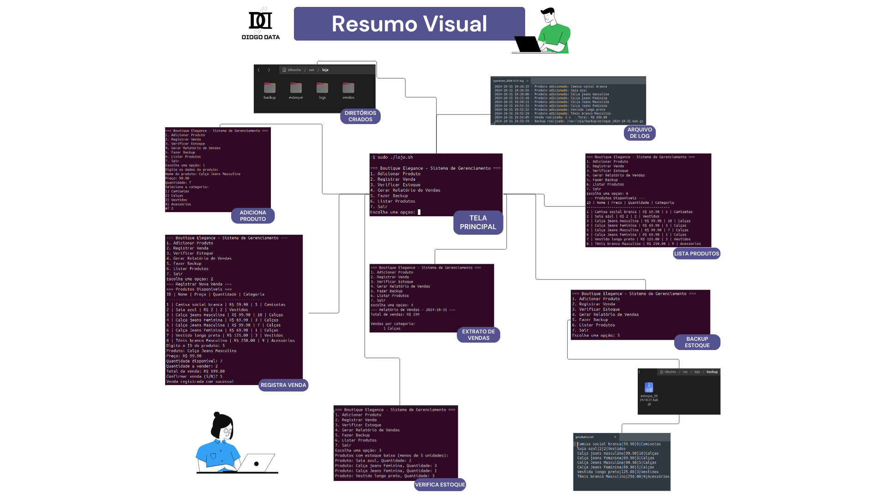

## Executive summary

**Boutique Manager** is a **shell scripting project for a small clothing shop scenario**. Its command-line menu brings together product registration, inventory updates, sales, stock alerts, reporting, logging and backups.

The project originated from applying concepts studied in the [Hands-on Introduction to Linux Commands and Shell Scripting course](https://www.coursera.org/account/accomplishments/verify/30JGE2RZY8T4). It is a practical automation exercise, rather than a claim of deployment at a commercial retailer.



## Problem and requirements

A small retailer needs a consistent way to track products and stock, record sales, and avoid losing operational data. Repeating manual file updates can introduce inconsistencies and is difficult to audit.

The command-line solution aims to:

- register products and organize inventory by category;
- record sales with date, time and amounts;
- update stock after transactions, checking quantities before a sale;
- highlight low stock and report performance by category and period;
- keep operational logs and schedule backups;
- provide a simple menu for these operations.

## Architecture and data flow

```text
Command-line menu (Bash)
       │
       ├── Product registry ───► Inventory files
       ├── Sales workflow ────► Stock updates + sales records
       ├── Reports ───────────► Aggregations by period/category
       └── Operations ────────► Timestamped logs
                                      │
Cron schedules ──────────────────────► Backups / stock checks
```

**Input.** User selections and product/sales details entered in the terminal.

**Processing.** Shell functions manipulate structured files, validate stock quantities and prepare summaries.

**Output.** Updated inventory/sales records, reports, audit-style logs and backup artifacts.

### Architecture illustration



*Tip: open the diagram in a separate browser tab to zoom in.*

## Implementation decisions

**1. Bash modules and control flow.** The project uses functions, parameters, `if/then/else`, `case`, `while` and iteration over categories to keep the interactive menu maintainable.

**2. Text processing tools.** Pipes and command-line filters such as `awk`, `sort` and `uniq` support report generation and aggregation of inventory and sales information.

**3. Environment configuration and I/O.** Variables including `LOJA_DIR` and `DATA`, `export`, file patterns, command substitution and redirection organize execution paths and logs.

**4. Data integrity and auditability.** The implementation describes quantity checks before sales, temporary-file updates and timestamped operation logs.

**5. Scheduled operations.** Cron is used to schedule recurring backups and inventory checks. The original article describes daily backups and weekly inventory checks.

## Demo

The project provides a visual architecture diagram above and a [source repository](https://github.com/diogo-dantas/boutique-manager). 

## Testing and data quality

The following are **recommended tests**; a formal automated test suite was not documented:

- prevent sales when requested quantity exceeds available inventory;
- validate product registration with missing or invalid fields;
- check whether inventory changes are consistent with sales records;
- verify report totals with a small known dataset;
- test recovery when temporary-file writes fail;
- ensure log timestamps are present and meaningful;
- check Cron jobs and restoration from generated backups.

## Results and limitations

**Demonstrated deliverable:** a Bash-based management workflow for the described store scenario, combining sales, inventory, reports, logging and backups.

**Limitations:** there are no documented production users, measured time savings, concurrency guarantees or verified backup-restore benchmarks. Shell/file-based state management would require further hardening for multiple simultaneous users.

## Lessons learned and next steps

The case study shows how small shell utilities can be combined into a useful workflow. Future improvements could introduce shell linting (`shellcheck`), automated tests, explicit configuration management and a documented restore procedure for backups.

## Repository and references

- [Boutique Manager repository](https://github.com/diogo-dantas/boutique-manager)
- [Linux and Shell Scripting course certificate](https://www.coursera.org/account/accomplishments/verify/30JGE2RZY8T4)

Cover illustration credit: [gstudioimagen / Freepik](https://www.freepik.com/).
